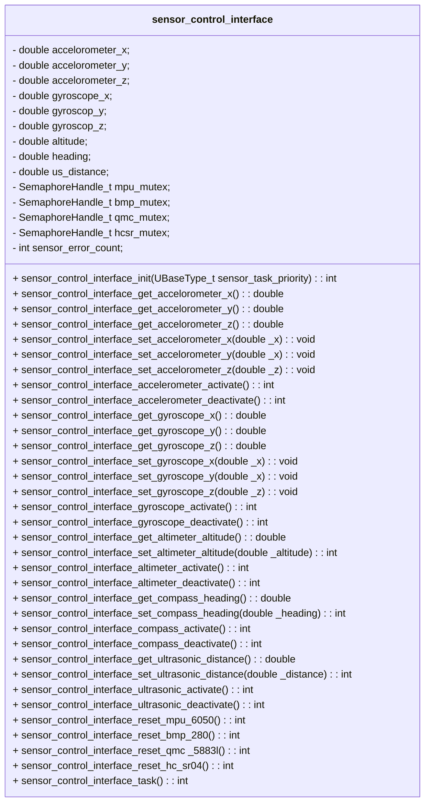

# Advanced Avionics Control System
Processor : *RP2040* (Raspberry Pi *Pico W*)
OS : *FreeRTOS*

---

# Sensor Control Interface
![[Sensor Control Interface.canvas|Sensor Control Interface]]
## Variables
There are going to be a set of *static* variables that contain all of the sensor data. These variables are going to be protected using mutexes since they will be continuously updated via the internal sensor reading task and continuously read through the various "public" methods. 

I need to do some research on what formats would be good for using the numbers in (i.e. should accelerator data be a double between 1 and -1 or is it better represented as an unsigned or signed int?)

## C2 Communication
Documentation for what all the C2 server needs can be found [[C2 Server#*peripheral*| here]]

---

## UML


## Public Methods
### General
*sensor_control_interface_init*
### Accelerometer
Getters:
*sensor_control_interface_get_accelerometer_x*
*sensor_control_interface_get_accelerometer_y*
*sensor_control_interface_get_accelerometer_z*
Setters:
*sensor_control_interface_set_accelerometer_x*
*sensor_control_interface_set_accelerometer_y*
*sensor_control_interface_set_accelerometer_z*
Activators:
*sensor_control_interface_accelerometer_activate*
*sensor_control_interface_accelerometer_deactivate*

### Gyroscope
Getters:
*sensor_control_interface_get_gyroscope_x*
*sensor_control_interface_get_gyroscope_y*
*sensor_control_interface_get_gyroscope_z*
Setters:
*sensor_control_interface_set_gyroscope_x*
*sensor_control_interface_set_gyroscope_y*
*sensor_control_interface_set_gyroscope_z*
Activators:
*sensor_control_interface_gyroscope_activate*
*sensor_control_interface_gyroscope_deactivate*

### Altimeter
Getters:
*sensor_control_interface_get_altimeter_altitude*
Setters:
*sensor_control_interface_set_altimeter_altitude*
Activators:
*sensor_control_interface_altimeter_activate*
*sensor_control_interface_altimeter_deactivate*

### Compass
Getters:
*sensor_control_interface_get_compass_heading*
Setters:
*sensor_control_interface_set_compass_heading*
Activators:
*sensor_control_interface_compass_activate*
*sensor_control_interface_compass_deactivate*

### Ultrasonic
Getters:
*sensor_control_interface_get_ultrasonic_distance*
Setters:
*sensor_control_interface_set_ultrasonic_distance*
Activators:
*sensor_control_interface_ultrasonic_activate*
*sensor_control_interface_ultrasonic_deactivate*

## Internal Methods
### Threading
*sensor_control_interface_task*

### Error Handling
*sensor_control_interface_reset_mpu_6050*
*sensor_control_interface_reset_bmp_280*
*sensor_control_interface_reset_qmc _5883l*
*sensor_control_interface_reset_hc_sr04*

# Actuator Control Interface
![[Actuator Control Interface.canvas|Actuator Control Interface]]
## Diagrams
```c
int calculatePowerChange(int currentPower, int targetPower, int rateOfChange) {
    // Ensure rateOfChange is within the valid range (1-100)
    rateOfChange = max(1, min(100, rateOfChange));

    // Calculate the remaining difference between currentPower and targetPower
    int remainingDifference = targetPower - currentPower;

    // Calculate the adder/subtractor for the given rate of change
    int change = (remainingDifference * rateOfChange) / 100;

    // Ensure a minimum change to prevent very slow transitions
    change = max(change, MIN_CHANGE);  // Adjust MIN_CHANGE as needed

    return change;
}

```
## C2 Communication
Documentation for what all the C2 server needs can be found [[C2 Server#*actuator*| here]]

# Master Control Interface
The master_control_interface is responsible for high level control over the UAV.

## C2 Communication
Documentation for what all the C2 server needs can be found [[C2 Server#*flight data*| here]]
